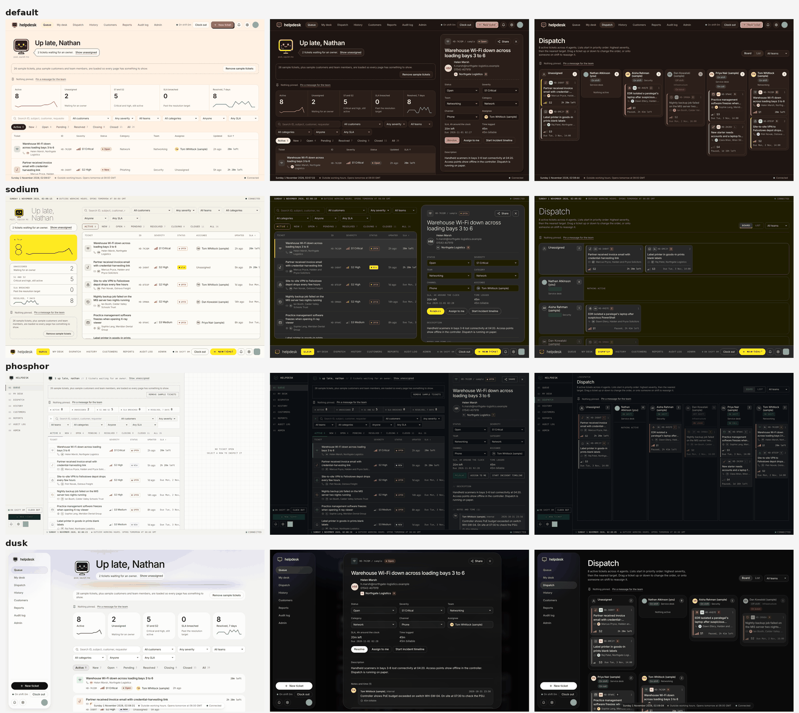

<p align="center"></p>

# helpdesk

[](LICENSE) [](../../actions/workflows/check.yml)

A free, open-source ticketing system for IT, security and networking teams. It has a queue, auto-assignment, SLAs, customers, time tracking and incident timelines, and Ping, a small terminal who keeps you company.

Open it in a browser and it works straight away, saving to that browser. Connect your own backend and it becomes a shared, signed-in helpdesk for the whole team.



## Install

**Single-file edition.** Nothing to install. Open or host `single-file/index.html`.

**The app** (React + TypeScript, built with Vite). Needs Node.js 22.6 or later.

```sh
git clone <this repo> helpdesk && cd helpdesk
npm install
npm run build        # one self-contained page: dist/index.html
```

Both editions have the same features and work with the same backend. Pick whichever suits you. The app depends only on React to run, and on Vite and TypeScript to build.

## Use

```sh
npm run dev                # development server with live reload
npm run dev -- --mode dusk # …in another style
npm test                   # unit tests
npm run build              # type-check and build every style into dist/
npm run styles             # remake the single-file style copies
npm run smoke              # browser test of both editions (needs Playwright)
```

On first open, a short setup asks for your helpdesk's name, teams and hours. Or choose **Explore with sample data** to look around first.

## Styles

Each style changes the look and the layout. The features are the same in all of them.

| Style | | Single-file | App |
| --- | --- | --- | --- |
| **default** | Warm, rounded cards, five colour themes | `single-file/index.html` | `dist/index.html` |
| **sodium** | Control room: bottom navigation, Dispatch lanes | `single-file/sodium/` | `dist/sodium/` |
| **phosphor** | Three-pane terminal console | `single-file/phosphor/` | `dist/phosphor/` |
| **dusk** | Floating sidebar, ticket cards | `single-file/dusk/` | `dist/dusk/` |

To make your own, see [styles/README.md](styles/README.md).

## Features

- **Queue, My desk, Dispatch and History**, each as a board or a list
- **Auto-assign** by category to the first available agent on a ranked list
- **Customers** with contacts, sites, SLA targets and their own ticket ID prefix
- **SLAs** in working hours, paused while a ticket is pending
- **Time tracking** with CSV export, and **incident timelines** as Markdown
- **Shifts, requests and approvals**, and **pinned messages** from managers
- **Reports, audit log** and manager-only **Admin**
- **CSV import**, and **backup and restore** as one file

## Hosting

helpdesk is the front end only. You bring the server, database and sign-in. The page talks to them through one adapter script (`window.helpdesk.use(name)`), so it fits whatever you already run.

- [DEPLOYMENT.md](DEPLOYMENT.md): step by step, from choosing a backend to go-live
- [PLATFORM.md](PLATFORM.md): the adapter reference and the access rules your server must enforce
- `public/platform.example.js`: an adapter to start from
- `public/adapter-test.html`: checks your adapter
- `Dockerfile`, `nginx.conf`: serve both editions with security headers

The included GitHub Pages workflow publishes every style for free on public repositories (**Settings › Pages › Source: GitHub Actions**).

## Layout

```
src/               the app: core/ (no React), views/, panels/, dialogs/, shell/, ui/
single-file/       the single-file edition, plus a generated copy per style
styles/            style packs: style.json and style.css each
public/            example adapter and adapter test
scripts/styles.mjs builds the style copies
tests/             unit tests (node:test) and the browser smoke test
assets/logo/       the logo
```

More detail is in [ARCHITECTURE.md](ARCHITECTURE.md). Contributions are welcome: see [CONTRIBUTING.md](CONTRIBUTING.md), [SECURITY.md](SECURITY.md) and [CHANGELOG.md](CHANGELOG.md).

## Licence

[MIT](LICENSE). The fonts (Bricolage Grotesque, Geist, Geist Mono and the styles' fonts) load from Google Fonts under the SIL Open Font License.
